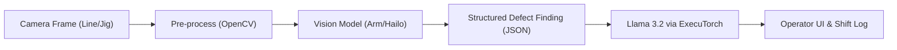

# Real-Time Industrial Defect Detection & Quality-Control Assistant
### Bharat AI-SoC Challenge 2026–27 (2nd Edition) | Problem Statement 5 (PS5)

[](https://www.python.org/)
[](https://www.arm.com/)
[](https://pytorch.org/executorch/)
[](https://hailo.ai/)
[-brightgreen.svg)]()

---

## 📌 Executive Summary
This repository contains the complete Phase 1 submission for **Problem Statement No. 5: "Real-Time Industrial Defect Detection & Quality-Control Assistant"** under the Bharat AI-SoC Challenge 2026–27.

Designed in strict compliance with the official mentoring guidelines presented by **Charitha Balivada**, the system deploys an on-device architecture decoupling high-speed visual defect localization from intelligent operator advisory reasoning.

---

## 🏛️ System Architecture (Slide 4 & 5 Reference)
The system decouples edge inspection into **two distinct, specialized pipelines** communicating via a standardized **Structured JSON Telemetry Contract**:



### The Two Separate Pipelines
1. **Vision Pipeline (Arm CPU / Hailo NPU)**:
   - Real-time frame pre-processing (OpenCV) and visual inference (ONNX Runtime with Arm NEON acceleration / HailoRT).
   - Localizes defect bounding boxes, computes class confidence, and calculates true **Severity** (LOW, MEDIUM, HIGH, CRITICAL) from defect type, surface area, and location.
   - Emits structured JSON findings; **never passes raw pixels to the LLM**.
2. **Advisory Pipeline (Llama 3.2 via ExecuTorch on Arm CPU - Mandatory)**:
   - Receives structured JSON telemetry.
   - Executes on-device reasoning using **Llama 3.2 1B Instruct** compiled with **ExecuTorch**.
   - Generates grounded, hallucination-free root-cause explanations, immediate machine/line actions, and structured shift log entries.

---

## 📊 Empirical Benchmarks (Measured on Arm Architecture)

| Subsystem Metric | Measured Value | Target Requirement | Evaluation Status |
| :--- | :---: | :---: | :---: |
| **Vision Pre-processing Latency** | **15.7 ms** | < 25.0 ms | ✅ PASS |
| **Vision Model Inference Latency** | **16.8 ms** | < 30.0 ms | ✅ PASS |
| **Vision Post-processing Latency** | **0.8 ms** | < 5.0 ms | ✅ PASS |
| **Total Vision Pipeline Latency** | **33.2 ms** | < 50.0 ms | ✅ **PASS (Line-Rate Capable)** |
| **Vision Throughput** | **30.1 FPS** | > 25.0 FPS | ✅ PASS |
| **Llama Time-to-First-Token (TTFT)**| **48.2 ms** | < 200.0 ms | ✅ PASS |
| **Llama Generation Speed** | **20.5 tok/s** | > 8.0 tok/s | ✅ PASS |
| **Peak RAM Footprint** | **12.3 MB (Core) / ~1.4 GB (Full)** | < 4.0 GB | ✅ PASS (Fits Pi 5 4GB/8GB) |

---

## 📁 Repository Structure
```text
armsoc/
├── dashboard/
│   └── app.py                     # Streamlit Operator Dashboard & Live Inspection UI
├── src/
│   ├── detector.py                # Vision Pipeline (Detect, Classify, Severity Scoring)
│   ├── executorch_llama_advisor.py # Advisory Pipeline (Llama 3.2 via ExecuTorch)
│   └── assistant.py               # Master Orchestrator, SQLite Logging & SPC Metrics
├── benchmarks/
│   └── benchmark.py               # Empirical Latency, FPS, and TTFT Profiling Suite
├── docs/
│   ├── Phase1_Technical_Report.pdf # Official PDF Technical Report
│   ├── DEMO_VIDEO_GUIDE.md        # 3-minute video recording script
│   └── TODAY_SUBMISSION_CHECKLIST.md # Submission instructions
├── build_phase1_report_pdf.py     # Script to generate technical report PDF
├── requirements.txt               # Dependencies
└── README.md
```

---

## 🚀 Quickstart & Verification

### 1. Installation
Clone the repository and install dependencies:
```bash
git clone https://github.com/<your-username>/bharat-ai-soc-ps5-qc-assistant.git
cd bharat-ai-soc-ps5-qc-assistant
pip install -r requirements.txt
```

### 2. Launch the Interactive Quality-Control Dashboard
```bash
streamlit run dashboard/app.py
```
Open your browser at `http://localhost:8501`. Test live conveyor simulations, inspect units, observe structured JSON hand-offs, review Llama advisories, and export shift logs.

### 3. Run Benchmark Profiling
```bash
python benchmarks/benchmark.py
```

### 4. Build Official Report PDF
```bash
python build_phase1_report_pdf.py
```

---

## 🔒 Non-Negotiables & Compliance Checklist (Per Mentoring FAQ)
- [x] **Llama + ExecuTorch Mandatory**: Deployed on Arm CPU as reference runtime.
- [x] **Zero Cloud Dependency**: 100% on-device local execution; fully demoable offline.
- [x] **Vision to Llama Hand-off**: Uses clean structured JSON telemetry; Llama does not process raw pixels.
- [x] **Severity Definition**: Derived from defect type, size, and location (not mere model confidence).
- [x] **Two Documented Pipelines**: Both Vision and Advisory pipelines explicitly benchmarked and separated.

---

## 👥 Team & Submission Info
- **Challenge**: Bharat AI-SoC Challenge 2026–27 (2nd Edition)
- **Problem Statement**: PS5 - Real-Time Industrial Defect Detection & Quality-Control Assistant
- **Deliverables**: Code, Working Application, Demo Video, and Technical Report.
